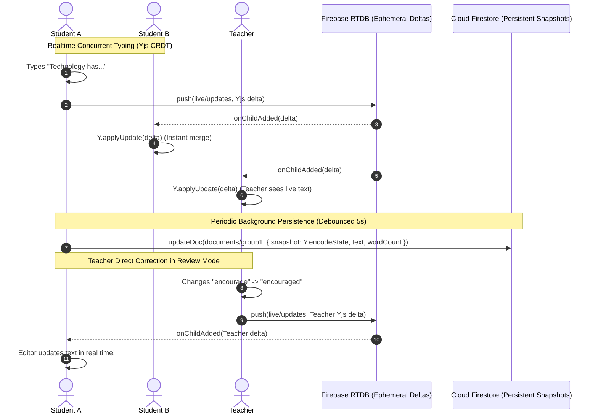
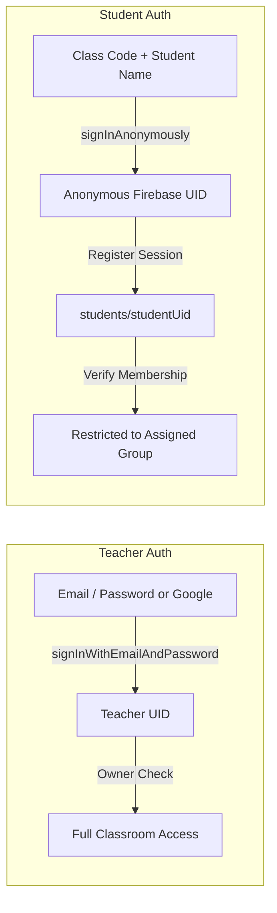
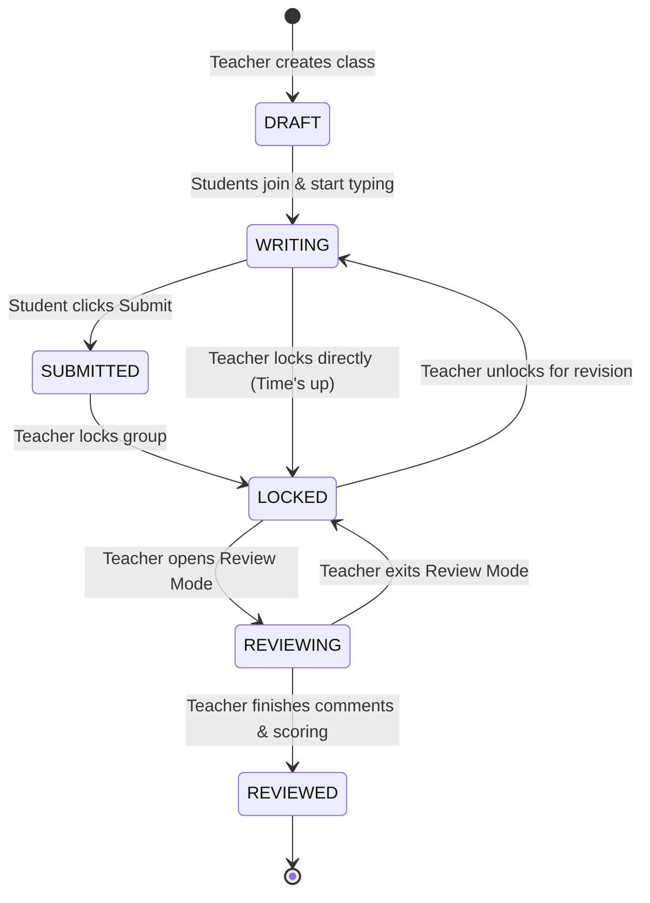

# Architecture Design Document
# Classroom Collaborative Writing Platform

## 1. System Overview

The **Classroom Collaborative Writing Platform** is a serverless, realtime web application engineered for classroom group writing tasks (e.g., IELTS, TOEFL, high school, or academic essay writing). It enables students to collaborate in small groups on shared documents in real time without creating accounts, while empowering teachers to monitor all groups live, lock submissions, and directly edit, highlight, and comment on the original student text before the entire class.

### Core Tenets
1. **Zero Barrier for Students**: Anonymous session authentication; only Class Code and Name required.
2. **True Concurrent Collaboration**: CRDT-based synchronization (Yjs) eliminates text loss, race conditions, and overwrite conflicts.
3. **100% Free-Tier Operation**: Designed to run comfortably within Firebase Spark (free) and GitHub Pages limits.
4. **Strict Security Boundaries**: Security is enforced at the database rule layer (Firestore & RTDB), not merely hidden in the UI.
5. **Teacher Direct Review**: Live teacher correction on the original document with instant student-facing reflection.

```mermaid
flowchart TD
    subgraph Teacher Device
        T[Teacher Browser]
        T_Auth[Firebase Auth - Email/Google]
        T_Dash[Teacher Dashboard & Live Grid]
        T_Review[Review Mode & Tiptap Editor]
    end

    subgraph Student Devices
        S1[Student A - Group 1]
        S2[Student B - Group 1]
        S_Auth[Firebase Anonymous Auth]
        S_Editor[Tiptap Collaborative Editor]
    end

    subgraph Firebase Cloud (Free Tier)
        Auth[Firebase Authentication]
        Firestore[(Cloud Firestore\nPersistent Data & Security Rules)]
        RTDB[(Firebase Realtime Database\nEphemera, Yjs Deltas, Presence)]
    end

    subgraph Deployment
        GHP[GitHub Pages Hosting]
        GHA[GitHub Actions CI/CD]
    end

    T_Auth -->|Sign In| Auth
    S_Auth -->|Anonymous Token| Auth
    T --> Firestore
    T --> RTDB
    S1 --> Firestore
    S1 --> RTDB
    S2 --> RTDB
    S2 --> Firestore
    GHA -->|Build & Deploy| GHP
```

---

## 2. Frontend Architecture

The frontend is built with **React 18/19**, **TypeScript**, **Vite**, and **Tailwind CSS**. It follows a modular, feature-oriented clean architecture:

```
src/
├── components/
│   ├── common/             # Button, Input, Modal, Toast, StatusBadge
│   ├── teacher/            # ClassCard, LiveGroupGrid, GroupPreview, MemberList
│   ├── student/            # JoinModal, GroupSelector, StudentHeader
│   └── editor/             # CollaborativeEditor, Toolbar, AnnotationSidebar, WordCounter
├── pages/
│   ├── auth/               # TeacherLogin, TeacherRegister
│   ├── teacher/            # TeacherDashboard, ClassDetail, LiveMonitoring, ReviewMode
│   └── student/            # StudentJoin, StudentWorkspace
├── services/
│   ├── firebase/           # app.ts, auth.ts, firestore.ts, rtdb.ts
│   ├── class/              # classService.ts (CRUD, code generation)
│   ├── group/              # groupService.ts (members, group lifecycle)
│   ├── document/           # documentService.ts (snapshots, lock/unlock)
│   ├── collaboration/      # yjsRtdbProvider.ts (CRDT sync over RTDB)
│   └── annotation/         # annotationService.ts (highlights, inline comments)
├── hooks/
│   ├── useAuth.ts          # Auth state (teacher vs anonymous student)
│   ├── useClass.ts         # Active class data & listener
│   ├── useGroup.ts         # Group metadata & student isolation check
│   ├── useDocument.ts      # Document snapshot & lock status
│   ├── useCollaboration.ts # Yjs doc binding, sync status, peer cursors
│   └── usePresence.ts      # Realtime presence via RTDB
├── types/                  # Domain entity definitions
├── utils/                  # Code generators, formatters, sanitizers
└── config/                 # Firebase config & constants
```

### Routing Strategy
To guarantee 100% compatibility with **GitHub Pages** (which serves static assets without server-side rewrite capabilities), routing is implemented using React Router `HashRouter` (`/#/teacher`, `/#/student/:classId/group/:groupId`). This completely avoids 404 errors on browser refresh without requiring custom redirect hacks.

---

## 3. Realtime Synchronization & Collaborative Editing Architecture

### Why Pure Firestore Synchronization Fails
In a classroom of 5 groups with 4 students per group typing simultaneously:
- If a document is stored as a single text field in Firestore and updated on change, concurrent edits from Student A and Student B will continuously overwrite each other (Last-Write-Wins race conditions).
- If keystrokes are sent to Firestore, a 90-minute writing session produces over 50,000 writes, immediately breaching Firestore's 20,000 daily write free quota.
- Firestore limits writes to ~1 write per second per document; typing will throttle and drop inputs.

### The Hybrid CRDT Solution
We employ **Yjs (Conflict-free Replicated Data Type)** combined with a two-tier backend:



1. **Ephemeral Realtime Transport (Firebase Realtime Database - RTDB)**:
   - When a student or teacher edits in Tiptap, Yjs computes a binary delta (`Uint8Array`).
   - The delta is pushed to RTDB at `classes/{classId}/live/{groupId}/updates`.
   - RTDB operations cost **$0 per read/write** (charges only on data stored < 1GB and bandwidth < 10GB/mo).
   - Other clients in the group receive the event via WebSocket in <100ms and merge it into their local `Y.Doc`.
   - Cursor positions and active selections are broadcast via RTDB Awareness (`classes/{classId}/live/{groupId}/awareness/{uid}`).

2. **Persistent Document Snapshots (Cloud Firestore)**:
   - Every 5-10 seconds of inactivity (or upon lock, submit, blur, or teacher review), the client saves a consolidated document snapshot to Firestore:
     - `contentSnapshot`: Compacted base64 binary state of the Yjs document (`Y.encodeStateAsUpdate(doc)`).
     - `textContent` & `htmlContent`: Rendered essay content for quick display in Teacher Live Grid without initializing full Yjs instances for all groups.
     - `wordCount`: Computed word count.
     - `updatedAt`: Server timestamp.
   - When a user joins or reloads, the initial state is hydrated in a single read from Firestore, after which RTDB streams any subsequent live deltas.
   - Old delta nodes in RTDB are trimmed/compacted on snapshot commit to maintain minimal storage footprint.

---

## 4. Annotation & In-Line Teacher Correction System

Teachers can highlight specific phrases in the student essay and attach pedagogical comments (e.g., grammar explanations, vocabulary recommendations).

### Data Structure (`classes/{classId}/documents/{groupId}/annotations/{annotationId}`)
```typescript
interface Annotation {
  id: string;
  documentId: string;
  groupId: string;
  authorId: string;
  authorName: string;
  type: 'highlight' | 'comment' | 'correction';
  selectedText: string;
  from: number;         // Relative position or anchor in document
  to: number;
  comment: string;
  color?: string;       // Yellow, Green, Pink, Blue
  resolved: boolean;
  createdAt: number;
  updatedAt: number;
}
```

### Inline Editor Integration
- In Tiptap, annotations are represented by a custom mark `annotationMark` with an `annotationId` attribute.
- When the teacher highlights text, Tiptap applies the mark and saves the annotation record to Firestore.
- Students and teachers subscribe to the group's `annotations` subcollection via `onSnapshot`.
- Clicking a highlighted span in the editor scrolls to and selects the comment in the sidebar; clicking a comment in the sidebar highlights the matching text in the editor.
- **Direct Text Correction**: Teacher can replace words directly in the editor. Because Teacher is a peer in the Yjs session, text substitutions propagate instantly to the students' screens.

---

## 5. Authentication & Session Identity



- **Teacher**: Authenticated using standard Firebase Auth (Email/Password or Google). The teacher's UID matches the `teacherId` field in the class document.
- **Student**: Uses **Firebase Anonymous Authentication** (`signInAnonymously(auth)`).
  - No email, password, or third-party OAuth account required.
  - Generates a cryptographically secure, unique anonymous `uid`.
  - When the student enters `WRIT26` and `Nguyen Van A`, the system stores the student session in Firestore at `classes/{classId}/students/{studentUid}`:
    ```json
    {
      "uid": "anon_xyz123",
      "name": "Nguyen Van A",
      "groupId": "group_1",
      "classId": "class_abc",
      "joinedAt": 1700000000
    }
    ```
  - If two students share the same name, they are uniquely distinguished by their `uid`.
  - Firestore Security Rules verify that `request.auth.uid` matches the registered `students` document for that group.

---

## 6. Firestore Data Model & Schema

```
classes/
  └── {classId}/
        ├── [document]: ClassMetadata
        │     ├── id: string
        │     ├── code: string ("WRIT26")
        │     ├── title: string ("IELTS Writing Task 2")
        │     ├── topic: string ("Some people believe technology...")
        │     ├── teacherId: string
        │     ├── teacherName: string
        │     ├── status: "ACTIVE" | "ARCHIVED"
        │     ├── allowStudentGroupSelection: boolean
        │     ├── createdAt: timestamp
        │     └── updatedAt: timestamp
        │
        ├── groups/
        │     └── {groupId}/
        │           ├── id: string
        │           ├── classId: string
        │           ├── name: string ("Group 1")
        │           ├── members: Array<{ uid: string, name: string, joinedAt: number }>
        │           ├── status: "WRITING" | "SUBMITTED" | "LOCKED" | "REVIEWING" | "REVIEWED"
        │           ├── locked: boolean
        │           └── createdAt: timestamp
        │
        ├── students/
        │     └── {studentUid}/
        │           ├── uid: string
        │           ├── classId: string
        │           ├── groupId: string
        │           ├── name: string
        │           ├── joinedAt: timestamp
        │           └── lastSeenAt: timestamp
        │
        ├── documents/
        │     └── {groupId}/
        │           ├── id: string (matches groupId)
        │           ├── classId: string
        │           ├── groupId: string
        │           ├── textContent: string
        │           ├── htmlContent: string
        │           ├── contentSnapshot: string (base64 Yjs update)
        │           ├── wordCount: number
        │           ├── status: "WRITING" | "SUBMITTED" | "LOCKED" | "REVIEWING" | "REVIEWED"
        │           ├── locked: boolean
        │           ├── updatedBy: string
        │           ├── updatedAt: timestamp
        │           └── version: number
        │
        └── annotations/
              └── {annotationId}/
                    ├── id: string
                    ├── documentId: string
                    ├── groupId: string
                    ├── authorId: string
                    ├── authorName: string
                    ├── type: "highlight" | "comment" | "correction"
                    ├── from: number
                    ├── to: number
                    ├── selectedText: string
                    ├── comment: string
                    ├── resolved: boolean
                    ├── createdAt: timestamp
                    └── updatedAt: timestamp
```

---

## 7. Security Rules Architecture

Security is enforced at the database level so client-side tampering (e.g. changing the URL route from `group1` to `group2`) results in an immediate `PERMISSION_DENIED` error from Firebase.

### Firestore Rules Overview (`firestore.rules`)
```javascript
rules_version = '2';
service cloud.firestore {
  match /databases/{database}/documents {
    
    // Helper functions
    function isAuthenticated() {
      return request.auth != null;
    }
    
    function isClassTeacher(classId) {
      return isAuthenticated() && 
        request.auth.uid == get(/databases/$(database)/documents/classes/$(classId)).data.teacherId;
    }
    
    function getStudent(classId) {
      return get(/databases/$(database)/documents/classes/$(classId)/students/$(request.auth.uid)).data;
    }
    
    function isStudentInGroup(classId, groupId) {
      return isAuthenticated() && 
        getStudent(classId).groupId == groupId;
    }

    match /classes/{classId} {
      allow read: if isAuthenticated();
      allow create: if isAuthenticated();
      allow update, delete: if isClassTeacher(classId);

      // Groups collection
      match /groups/{groupId} {
        allow read: if isAuthenticated();
        allow write: if isClassTeacher(classId);
      }

      // Students collection
      match /students/{studentUid} {
        allow read: if isAuthenticated();
        allow create: if isAuthenticated() && request.auth.uid == studentUid;
        allow update: if isClassTeacher(classId) || request.auth.uid == studentUid;
        allow delete: if isClassTeacher(classId);
      }

      // Documents collection
      match /documents/{groupId} {
        // Teacher can read all; student can ONLY read their own assigned group
        allow read: if isClassTeacher(classId) || isStudentInGroup(classId, groupId);
        
        // Writes allowed only if teacher OR (student in group AND document NOT locked)
        allow write: if isClassTeacher(classId) || 
          (isStudentInGroup(classId, groupId) && 
           resource.data.locked == false && 
           request.resource.data.locked == false);
      }

      // Annotations collection
      match /annotations/{annotationId} {
        allow read: if isClassTeacher(classId) || 
          isStudentInGroup(classId, resource.data.groupId);
        // Only teacher can create/edit annotations
        allow write: if isClassTeacher(classId);
      }
    }
  }
}
```

---

## 8. Presence System (RTDB)

Presence is tracked with zero Firestore writes via the Firebase Realtime Database:
- Student connects to RTDB at `classes/{classId}/presence/{groupId}/{studentUid}`.
- Using `.info/connected`:
  ```javascript
  const presenceRef = ref(rtdb, `classes/${classId}/presence/${groupId}/${studentUid}`);
  const connectedRef = ref(rtdb, '.info/connected');
  onValue(connectedRef, (snap) => {
    if (snap.val() === true) {
      onDisconnect(presenceRef).remove();
      set(presenceRef, {
        name: studentName,
        online: true,
        lastSeen: serverTimestamp()
      });
    }
  });
  ```
- Teacher dashboard listens to `classes/{classId}/presence` to view who is currently online in each group in real time.

---

## 9. Document Lifecycle State Machine



- **WRITING**: All students in group have full read/write access.
- **SUBMITTED**: Students indicate they have completed their draft. Still editable until locked by teacher.
- **LOCKED**: Document becomes read-only for students. Firestore rules reject any student mutation.
- **REVIEWING**: Teacher actively edits original text and adds annotations. Students observe changes in real time.

---

## 10. Free-Tier Quota Budget & Resource Consumption

### Scenario: 1 Teacher, 20 Students, 5 Groups, 90-Minute Class Session

| Resource | Free Tier Quota | Estimated Usage per 90-min Session | % Quota Consumed | Status |
|----------|-----------------|-----------------------------------|------------------|--------|
| **Firestore Reads** | 50,000 / day | ~200 - 500 reads | ~0.6% | Extremely Safe |
| **Firestore Writes** | 20,000 / day | ~600 - 1,000 writes (debounced snapshots) | ~4.0% | Extremely Safe |
| **Firestore Stored Data** | 1 GB total | ~2 MB per session | Negligible | Safe |
| **RTDB Simultaneous Connections** | 100 concurrent | 21 connections (1 teacher + 20 students) | 21% | Safe for classroom |
| **RTDB Network Egress** | 10 GB / month | ~5 MB per session (compressed Yjs deltas) | ~0.05% | Extremely Safe |
| **Firebase Auth** | 50,000 MAU / month | ~20 anonymous sessions | Negligible | Safe |
| **GitHub Pages Hosting** | 100 GB bandwidth / mo | Static bundle ~1.5 MB cached | Negligible | 100% Free |

> [!NOTE]
> By offloading keystroke streaming and presence to RTDB and debouncing persistent snapshots to Firestore, the application will **never exceed Firebase Spark free tier** during standard classroom usage.

---

## 11. Known Limitations & Mitigation

1. **Max Simultaneous Connections on Free RTDB**:
   - Limit: 100 concurrent connections.
   - Mitigation: A single class typically has 20-40 participants, well within the 100 limit. For multi-class enterprise scaling, upgrading to Firebase Blaze (pay-as-you-go) costs mere cents per gigabyte.
2. **Offline Collaboration**:
   - Students working offline can continue typing locally in their editor. When internet reconnects, Yjs merges the offline edits automatically. However, offline collaboration across multiple disconnected peers in the same room requires an active connection to Firebase RTDB.
3. **Class Code Collisions**:
   - 6-character alphanumeric uppercase codes (e.g. `WRIT26`, excluding ambiguous characters like `0/O`, `1/I`) provide over 1 billion permutations. Active codes are queried against Firestore to guarantee uniqueness.

---

## 12. Future Scalability Roadmap

1. **Teacher AI Co-Pilot**: Automated essay scoring (IELTS Band score descriptor evaluation, grammar checks).
2. **Version History & Diff Viewer**: Step-by-step playback of document evolution and individual student contribution attribution.
3. **Peer Review Mode**: Teacher can dynamically allow Group 1 to review Group 2's document with restricted comment-only privileges.
4. **Export Capabilities**: Export final essay with annotations to PDF, Word docx, or Google Docs.
